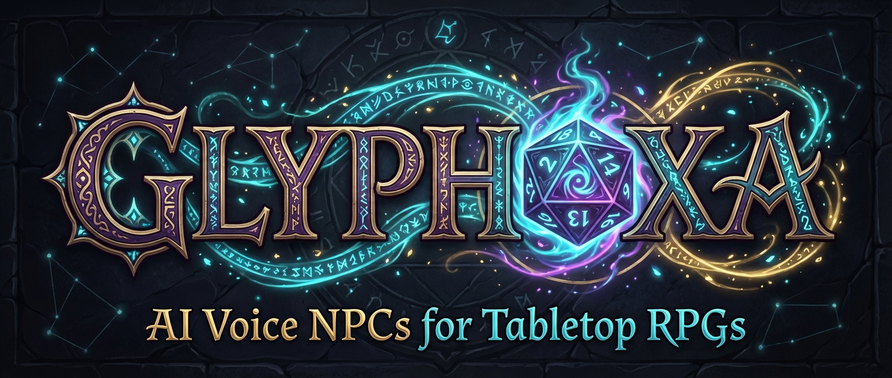

# 🐉 Glyphoxa

[](https://github.com/MrWong99/Glyphoxa/actions/workflows/ci.yml)
[](https://go.dev)
[](LICENSE)
[](https://goreportcard.com/report/github.com/MrWong99/Glyphoxa)
[](https://codecov.io/github/MrWong99/Glyphoxa)

**AI voice NPCs and a per-Campaign knowledge base for tabletop RPGs.**

---

## What is Glyphoxa?

Glyphoxa is a multi-tenant TTRPG voice-and-knowledge platform. AI **Agents**
join a Discord **Voice Session**, voice a Campaign's **Character NPCs**, and
assist the **GM** — persisting **Transcripts** and a per-Campaign **Knowledge
Graph**. It never replaces the human storyteller; it is a co-pilot for the GM.

The **GM** runs the game from Discord (**Slash Commands**) and from an operator
web console (Provider Configs, Campaigns, Agents, Knowledge Graph, live
sessions). Written in Go for native concurrency and a streaming voice pipeline.

> **Public beta** — running as a hosted, multi-tenant service and self-hostable
> from the same image. Pre-1.0: the RPC API and configuration may still change
> between releases (`vX.Y.Z` tags; never run a release below v0.16.0). The system
> overview, including where the code diverges from the ADRs, lives in
> [docs/architecture.md](docs/architecture.md).

## Modes

One binary, `cmd/glyphoxa`, runs one **Mode** at a time via `-mode`
([ADR-0005](docs/adr/0005-single-binary-modes-no-audio-rpc.md)). The default is
`all` — the self-host target ([ADR-0034](docs/adr/0034-deployment-artifacts.md)).

| Mode | What it runs |
|------|--------------|
| `all` (default) | Both halves in one process: the web tier plus the per-Tenant Discord presence (Slash Commands) and the voice loop, in-process. Auto-applies migrations at startup. The self-host shape. |
| `web` | A **Web Instance**: the operator console + Connect RPC API. Opens no Discord gateway. Starts and stops Voice Sessions through the Postgres claim plane ([ADR-0057](docs/adr/0057-shared-voice-worker-pool-multi-tenant.md)) for a pool of `voice` workers to pick up. Assumes a current schema (no auto-migrate). |
| `voice` | A **Voice Instance**. With a database and no `-guild`/`-channel` it is a **claim-plane worker**: it claims Voice Session intents, drives them, and — while it holds the elected presence-owner row — serves the Slash Commands (ADR-0057). With `-guild`/`-channel` (or `-hardcoded`) it is the legacy standalone node joining one static channel. No web API. |

`all` is the single-process deployment; `web` + N × `voice` is the split
deployment the hosted service runs. See [docs/architecture.md §1](docs/architecture.md)
for the process topology.

## 🚀 Quick Start (self-host)

Glyphoxa self-hosts as a single **Operator**-owned deployment. The full runbook —
every environment variable, the Discord OAuth app, and the operator allowlist —
is [docs/configuration.md](docs/configuration.md); the game-running walkthrough is
[docs/quickstart-gm.md](docs/quickstart-gm.md).

### Fastest: Docker Compose

`compose.yml` stands up a pgvector Postgres + the published Glyphoxa image
(`ghcr.io/mrwong99/glyphoxa`) in `-mode all`, which auto-migrates at startup —
so this reaches the login screen against a migrated DB with no separate
migrate step ([ADR-0034](docs/adr/0034-deployment-artifacts.md)). A machine
with only Docker needs nothing else:

```sh
cp .env.example .env              # fill GLYPHOXA_SECRET + DISCORD_OAUTH_* + GLYPHOXA_OPERATOR_IDS (docs/configuration.md §5–§6)
docker compose up
```

Then open `http://127.0.0.1:8080` and sign in with Discord. For a bare-metal
box, `deploy/glyphoxa.service` runs the same `-mode all` under systemd
(docs/configuration.md §10). To run against a source checkout instead of the
published image, `docker compose up --build` falls back to the local `build:`
(needs `make proto` + `(cd web && npm ci && npm run build)` first — see
docs/configuration.md §9).

### Build from source

### Prerequisites

- **Go 1.27+**
- **A C toolchain (gcc), `pkg-config` and the libopus headers** (`libopus-dev`
  on Debian/Ubuntu, `opus-devel` on Fedora, `opus` on Arch,
  `brew install opus pkg-config` on macOS). The voice-capable build links the
  outbound Opus encoder against libopus via CGO
  ([ADR-0034 amendment](docs/adr/0034-deployment-artifacts.md)); DAVE/MLS
  (dave-go) and the Silero VAD (pure-Go forward pass) need nothing native.
- **Node.js 20+ and npm** — the console bundle is embedded into the binary
- **[buf](https://buf.build/docs/installation)** — generates the Connect/protobuf stubs
- **Postgres with the [pgvector](https://github.com/pgvector/pgvector) extension**

There are two builds. `make build-live` compiles the production tags
(`opus dave nolibopusfile`, the same as the container image) and is the one
that can join a voice channel. `make build` is the untagged pure-Go build: it
serves the console, migrations and CLI, but links stub Opus/DAVE code, so every
Voice Session fails — it logs a WARN at boot in `voice`/`all` Mode, and
`glyphoxa version` shows which build you have.

### Build & run

```sh
git clone https://github.com/MrWong99/Glyphoxa.git
cd Glyphoxa

cp .env.example .env              # set at least DB + SECRET; -mode all also needs the DISCORD_OAUTH_* vars + GLYPHOXA_OPERATOR_IDS — see docs/configuration.md §5–§6
source .env                       # the template is shell-sourced (export NAME='value')

make proto                        # buf generate → gen/
(cd web && npm ci && npm run build)   # Vite bundle → internal/spa/dist
make build-live                   # → bin/glyphoxa (voice-capable; `make build` cannot do voice)

./bin/glyphoxa migrate up         # apply the schema (seed + explicit -mode web assume it is current)
./bin/glyphoxa seed               # seed the demo Tenant/Campaign/NPC (idempotent)
./bin/glyphoxa                    # -mode all is the default: serve the console + drive the voice loop
```

The default `-mode all` auto-applies migrations at startup, so a bare
`./bin/glyphoxa` needs no `migrate up` of its own — the explicit `migrate up`
above is only so `seed` (and an explicit `-mode web`) have a current schema.

Then open `http://127.0.0.1:8080` and sign in with Discord. The OAuth app and the
mandatory operator allowlist are set up in [docs/configuration.md](docs/configuration.md)
§5–§6.

## 🔌 Provider Support

Bring-your-own-keys (BYOK, [ADR-0004](docs/adr/0004-byok-provider-key-matrix.md)):
Provider Configs are Tenant-scoped and encrypted at rest. Shipped adapters
(`pkg/voice`):

| Component | Providers |
|-----------|-----------|
| **STT** | ElevenLabs — batch + streaming ([ADR-0042](docs/adr/0042-streaming-stt-speculative-memory-recall.md)) |
| **TTS** | ElevenLabs |
| **LLM** | Groq, Google Gemini, Anthropic, OpenAI-compatible endpoints |
| **Embeddings** | Ollama |
| **VAD** | Silero (local, pure-Go forward pass) |
| **Audio** | Discord (DAVE/MLS end-to-end encrypted voice) |
| **Storage** | PostgreSQL + pgvector |

The MVP provider matrix is Groq (LLM) + ElevenLabs (STT + TTS). See
[docs/architecture.md §2.7](docs/architecture.md) for which adapters are wired
into the live loop.

## ✨ What ships today

- 🖥️ **Web console** — a public landing page, Discord login and Tenant
  onboarding, then three Tenant screens: **Configuration** (Provider Configs,
  Discord settings, spend caps), **Campaign** (cast/Agents, Tool Grants, the
  Knowledge Graph wiki and graph view, Maps) and **Session** (Start/Stop, the
  live Transcript feed, NPC roster + mute, Highlights).
- 🎙️ **Live Character NPCs** — a Voice Session voices a Campaign's Character NPCs
  through a streaming VAD → STT → Address Detection → LLM → TTS pipeline.
- 💬 **Slash Commands** (registered in `all` Mode) — `/roll <dice>` for anyone in
  the Guild; and, GM-only, `/glyphoxa use|start|end|search|mute|muteall`.
- 🗺️ **Knowledge Graph** — a per-Campaign structured wiki of typed Nodes and
  Edges in Postgres ([ADR-0008](docs/adr/0008-postgres-knowledge-graph-layered.md)),
  authored from the Campaign screen and fed into NPC Hot Context.
- 📜 **Transcript persistence + search** — every Voice Session's Transcript Lines
  are persisted for replay-on-reload and full-text search
  ([ADR-0040](docs/adr/0040-transcript-line-persistence.md)), from the console or
  via `/glyphoxa search`.
- 💸 **Spend caps** — per-Tenant soft/hard cost caps on a Voice Session
  ([ADR-0046](docs/adr/0046-spend-meter-price-map-cap-mechanics.md)).
- 📦 **Container image + Helm chart** — one OCI image (`Dockerfile`) and a
  Kubernetes chart (`deploy/charts/glyphoxa`), with migrations as a pre-install
  hook Job ([ADR-0034](docs/adr/0034-deployment-artifacts.md)).

## 📦 Project Structure

```
Glyphoxa/
├── cmd/glyphoxa/          # Entry point: Modes (voice|web|all) + migrate/seed/export/billing/user/version subcommands
├── internal/
│   ├── auth/              # Discord OAuth, admission (allowlist/open), session cookies
│   ├── presence/          # Per-Tenant Discord clients + Slash Command surface
│   ├── rpc/               # Connect service handlers
│   ├── session/           # Voice Session Manager, claim-plane worker + intent control
│   ├── transcript/        # Transcript Line relay (SSE) + Chunk writer
│   ├── recall/ · recap/   # NPC memory recall over Transcript Chunks; session recaps
│   ├── kgfacts/ · knowledge/ # Knowledge Graph facts into Hot Context; KG authoring
│   ├── highlight/ · tape/ # Session Highlights and the audio tape they clip from
│   ├── worldmap/ · mapgen/ # Maps + Pins, generated maps
│   ├── bundle/            # Campaign Bundle import/export
│   ├── billing/ · spend/  # Plans + Usage Ledger; spend meter, price map, caps
│   ├── embedworker/       # Async embedding backfill
│   ├── storage/           # Postgres store, migrations, BYOK crypto
│   ├── observe/           # slog + Prometheus, /healthz, /readyz, flight recorder
│   ├── spa/ · web/        # Embedded SPA (go:embed internal/spa/dist); HTTP server + mounts
│   ├── wirenpc/           # Voice-loop composition root against a live Discord session
│   ├── discord*/          # Discord helpers (invite, guild, tag, messages, sharing)
│   └── ci/                # Repository invariant tests (workflows, image pins)
├── pkg/
│   ├── tool/              # Tool interface + registry + built-in Tools (dice, recall, KG, …)
│   ├── kgvocab/           # Knowledge Graph vocabulary
│   └── voice/             # Voice pipeline: transport, stt, tts, llm, embeddings, vad, wire, address, agent, orchestrator
├── proto/                 # Connect/protobuf service definitions (buf)
├── web/                   # Vite + React 19 SPA (web console)
├── deploy/charts/glyphoxa # Kubernetes Helm chart
├── docs/                  # Architecture, configuration, ADRs, agent runbooks
├── scripts/ · tests/      # Tooling and integration/e2e tests
└── assets/                # Banner + logo art
```

`gen/` (proto stubs) and `bin/` (build output) are generated and gitignored.

## 📖 Documentation

Start at the [documentation index](docs/README.md).

| Guide | Description |
|-------|-------------|
| [Architecture](docs/architecture.md) | Current-system overview; every subsystem names its ADR(s), and every ADR-vs-code divergence is recorded. |
| [Configuration & self-host setup](docs/configuration.md) | Every environment variable, the `.env` template, Postgres/pgvector, Discord OAuth, the operator allowlist, and the build order. |
| [GM quickstart](docs/quickstart-gm.md) | From a fresh clone to a talking Character NPC in a Discord voice channel. |
| [Live NPC run (developer)](docs/agents/live-npc-run.md) | The `voice`-mode live loop, `-hardcoded` NPC, and the `opus`/`dave` build tags. |
| [ADRs](docs/adr/) | The Architecture Decision Records behind every subsystem ([index](docs/README.md#architecture-decision-records)). |
| [Domain glossary](CONTEXT.md) | The canonical vocabulary used across the codebase and docs. |

## 🤝 Contributing

See [CONTRIBUTING.md](CONTRIBUTING.md) for development setup, code style, and
workflow. Domain terms follow [CONTEXT.md](CONTEXT.md); code of conduct is
[CODE_OF_CONDUCT.md](CODE_OF_CONDUCT.md).

- **Bugs** → [Bug Report](.github/ISSUE_TEMPLATE/bug_report.yml)
- **Features** → [Feature Request](.github/ISSUE_TEMPLATE/feature_request.yml)
- **Security** → [SECURITY.md](SECURITY.md)

## 📄 License

[GPL v3](LICENSE) © Glyphoxa Contributors
